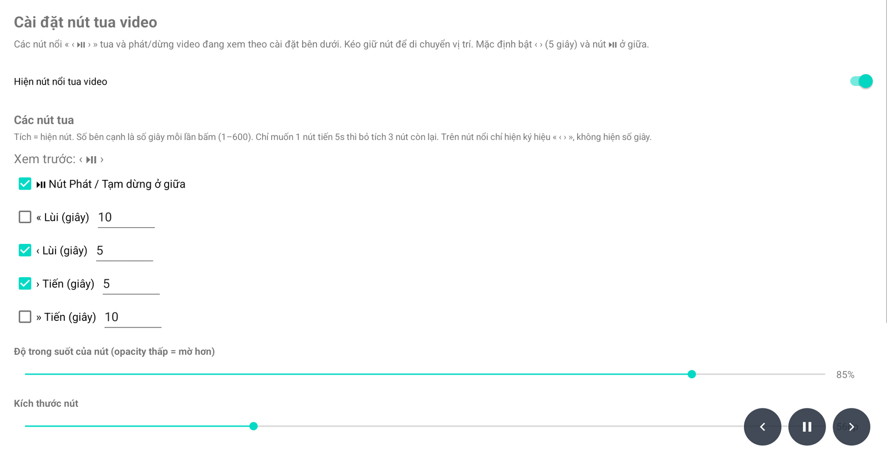
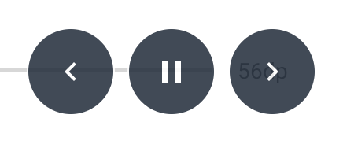
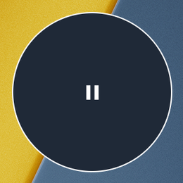
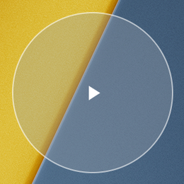

# Media Float Button

[Tiếng Việt](README.md) · **English**

**Add skip-back and skip-forward buttons to web videos on Android.**

Different websites use different video players. Some offer dedicated buttons to skip a few seconds; others only have a progress bar. If you miss a line and want to go back exactly five seconds, dragging the progress bar by hand can be fiddly, especially on a long video.

**Media Float Button** gives you the same floating controls across websites. Set your preferred skip intervals once, then tap to go backward or forward without looking for the equivalent button in each player. It is a Java Android app designed for tablets, with a single settings screen. It does not replace your video player or unlock seeking on videos that do not support it.

## Screenshots



| Default floating controls | One-cell widget — on | One-cell widget — off |
| :---: | :---: | :---: |
|  |  |  |

*Screenshots captured on a Xiaomi tablet with the app set to Vietnamese, cropped to show the relevant controls.*

## Features

- **Adjustable skip intervals:** enable up to four buttons (`«` `‹` `›` `»`) and set each to **1–600 seconds**. By default, `‹` and `›` are enabled and skip five seconds. `«` and `»` are off by default and configured for ten seconds.
- **Play/Pause:** an optional center button, enabled by default. Floating buttons show icons only, not the number of seconds.
- **Movable overlay:** drag the controls where you want them, set opacity to **10–100%**, and adjust button size from **40–96 dp**. Drag the controls onto the **✕** at the bottom of the screen to turn them off.
- **Home-screen toggle:** add the one-cell widget and tap it to turn the controls on or off. If you have the older two-cell widget, remove and re-add it.
- **Notification toggle:** optionally pin a notification with an on/off action. If Android reports that the notification was dismissed, the app reposts it while the setting is enabled. This is off by default and separate from the overlay service notification.
- **Vietnamese and English:** pick the language right in the app’s Settings screen (System default / Tiếng Việt / English); it applies immediately. If the system language is neither, the app falls back to Vietnamese. On Android 13 or later, the in-app choice stays in sync with the system **App languages** setting.

## Installation and use

1. Install the debug APK by following [Build from source](#build-from-source), then open **Media Float Button**.
2. Grant **Display over other apps**. To let the app interact with web player controls, open **Accessibility** settings and enable **Media Float Button**.
3. Turn on **Show floating video controls**, open a video in the browser, and tap `‹` or `›`. If it does not seek, try revealing the video’s progress bar before tapping again.

| Permission | What it is used for |
| --- | --- |
| **Display over other apps** | Shows the floating controls over the browser or the current app. |
| **Accessibility** | Finds controls in the active window and performs taps or swipes when you use a control. |
| **Notification access** *(optional)* | Finds active Android MediaSessions. The app does not read notification contents. |
| **Allow notifications** *(Android 13 or later)* | Allows the app to post its own notifications, including the optional pinned toggle. This is separate from **Notification access**. |

If Android blocks Accessibility for a sideloaded APK, look for **App info → ⋮ → Allow restricted settings**, then try again. On Xiaomi devices, if the controls disappear unexpectedly, recheck overlay permission and the app’s battery settings.

## How it works

The app uses Android media controls or interacts with the current player interface instead of sending arrow-key presses to the browser.

### Seeking

1. **With MediaSession:** if the player reports its position and supports `seekTo`, the app sends the current position plus or minus the configured interval. If direct seeking is unavailable through that session, the app can try **Rewind/Fast-forward** media keys instead; the player determines the skip interval in that case.
2. **Without a usable session:** the Accessibility service looks for the progress bar, reads the position and duration, then swipes to the calculated point. If it cannot find the bar, it tries tapping to reveal the player controls and then looks again.

### Play/Pause

The app tries **MediaSession** first. If that is unavailable, the Accessibility service tries clicking the player’s Play/Pause button or tapping the video area. If the active window cannot be inspected, it can send a system Play/Pause media key. When the player does not report playback state, the floating icon reflects the app’s estimate rather than a confirmed state.

### Privacy

The Accessibility service inspects the interface only when needed to handle a control action. Preferences are stored locally with `SharedPreferences`. The app manifest does not declare the `INTERNET` permission.

## Compatibility and limitations

- The app declares **Android 7.0 (API 24)** as its minimum version. It was tested with HTML5 video in **Microsoft Edge** on a **Xiaomi tablet running Android 16**. The tested Edge videos used the Accessibility fallback; results may differ across browsers and websites.
- Seeking may not work if the player provides neither a usable MediaSession position nor an accessible progress bar. The Accessibility fallback also cannot calculate a target for livestreams without a known duration.
- The Accessibility method can be off by a few seconds, especially with a long video or a short progress bar. Media-key fallback does not guarantee the configured interval either.
- If multiple apps are playing, the controls may target a different media session. Try pausing other playback sources if this happens.

## Build from source

Install **Android SDK Platform 37** through Android Studio’s SDK Manager. The project uses the Gradle Wrapper and configures the Gradle daemon to run on **JDK 25**. Android Studio can set the SDK path when you open the project.

```bash
./gradlew assembleDebug testDebugUnitTest
```

The APK is written to `app/build/outputs/apk/debug/app-debug.apk`. To install it on a device connected through ADB with **USB debugging** enabled:

```bash
./gradlew installDebug
```

On Windows, replace `./gradlew` with `.\gradlew.bat`.

### Source layout

| Component | Role |
| --- | --- |
| [`SettingsActivity`](app/src/main/java/com/tda/mediafloatbutton/SettingsActivity.java) | Settings screen and permission status. |
| [`OverlayService`](app/src/main/java/com/tda/mediafloatbutton/OverlayService.java) | Displays the floating controls and handles dragging and drag-to-dismiss. |
| [`SeekRouter`](app/src/main/java/com/tda/mediafloatbutton/SeekRouter.java) / [`PlayPauseRouter`](app/src/main/java/com/tda/mediafloatbutton/PlayPauseRouter.java) | Choose how to send each playback command. |
| [`MediaSessionController`](app/src/main/java/com/tda/mediafloatbutton/MediaSessionController.java) / [`MediaAccessibilityService`](app/src/main/java/com/tda/mediafloatbutton/MediaAccessibilityService.java) | Control playback through Android media sessions or the player interface. |
| [`OverlayControl`](app/src/main/java/com/tda/mediafloatbutton/OverlayControl.java) / [`ToggleWidget`](app/src/main/java/com/tda/mediafloatbutton/ToggleWidget.java) / [`PinnedNotification`](app/src/main/java/com/tda/mediafloatbutton/PinnedNotification.java) | Keep the app, widget, and notification toggle in sync. |

## Contributing

When reporting an issue, include the **device, Android version, browser, video page, enabled permissions**, and steps to reproduce. Remove personal information from screenshots before posting them.

## License

This project is released under the [MIT License](LICENSE).
