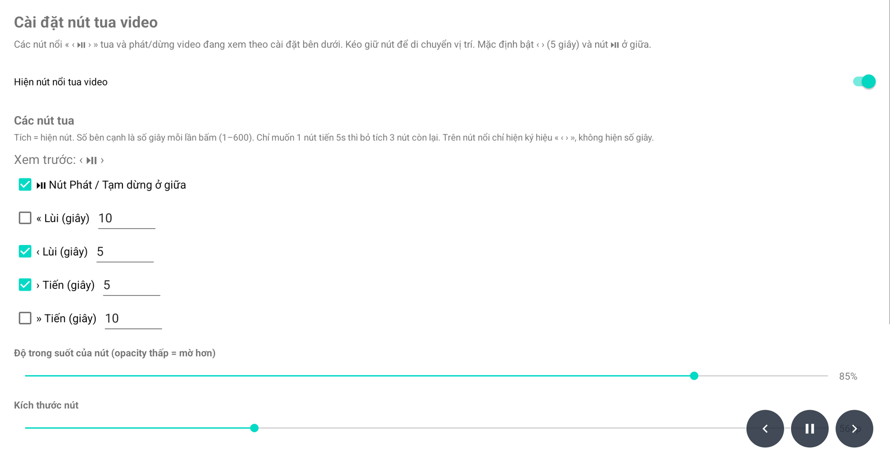
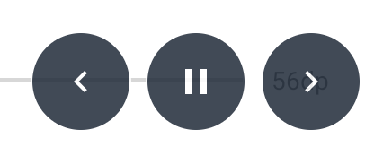
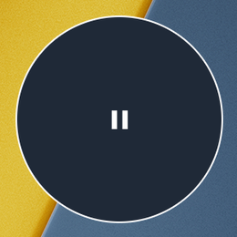
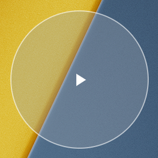

# Media Float Button

**Tiếng Việt** · [English](README.en.md)

**Thêm nút tua lùi và tua tiến cho video web trên Android.**

Khi xem video trong trình duyệt, mỗi website có thể dùng một trình phát khác nhau. Có trang có sẵn nút tua lùi hoặc tiến vài giây; có trang chỉ có thanh tiến trình. Nếu vừa bỏ lỡ một câu và muốn lùi đúng 5 giây, kéo thanh tiến trình bằng tay thường khó căn, nhất là với video dài.

**Media Float Button** thêm một cụm nút nổi dùng chung khi chuyển giữa các trang. Bạn đặt số giây một lần rồi chạm để tua lùi hoặc tiến, không cần tìm nút tương ứng trong từng trình phát. App được viết bằng Java, thiết kế cho tablet Android và chỉ có một màn hình Cài đặt. App không thay thế trình phát hay mở khóa khả năng tua cho video không hỗ trợ tua.

## Ảnh chụp màn hình



| Cụm nút nổi mặc định | Widget 1 ô — bật | Widget 1 ô — tắt |
| :---: | :---: | :---: |
|  |  |  |

*Ảnh chụp thật trên tablet Xiaomi, được cắt gọn để tập trung vào giao diện của app.*

## Tính năng

- **Tua lùi/tiến theo giây:** tối đa bốn nút `«` `‹` `›` `»`. Bật/tắt từng nút và đặt bước tua riêng từ **1–600 giây**. Mặc định `‹` lùi 5 giây và `›` tiến 5 giây; `«` và `»` tắt sẵn, với bước tua mặc định 10 giây.
- **Phát/Tạm dừng:** nút ở giữa, bật mặc định và có thể ẩn trong Cài đặt. Các nút nổi chỉ hiện biểu tượng, không hiện số giây.
- **Tùy chỉnh cụm nút:** kéo tới vị trí thuận tay, chỉnh độ đục từ **10–100%** và kích thước từ **40–96 dp**. Kéo cụm nút vào dấu **✕** ở đáy màn hình để tắt nhanh.
- **Bật/tắt từ màn hình chính:** thêm widget 1 ô rồi chạm vào vòng tròn để đổi trạng thái. Nếu đang dùng widget 2 ô từ bản cũ, hãy gỡ và thêm lại.
- **Bật/tắt từ thanh thông báo:** bật tùy chọn thông báo ghim trong Cài đặt để thêm một dòng có nút **Bật/Tắt nút nổi**. Khi nhận được sự kiện vuốt xóa, app đăng lại dòng này nếu tùy chọn ghim vẫn bật. Tùy chọn này tắt mặc định và tách riêng với thông báo hệ thống của dịch vụ nút nổi.
- **8 ngôn ngữ:** Tiếng Việt, English, 中文, 한국어, Русский, Deutsch, Français, Español. Mặc định app theo ngôn ngữ của máy; nếu máy dùng ngôn ngữ ngoài danh sách, app hiển thị tiếng Anh. Chọn ngôn ngữ ngay trong màn Cài đặt (ở cuối màn hình), đổi là áp dụng ngay. Từ Android 13, lựa chọn này đồng bộ với mục **Ngôn ngữ ứng dụng** của hệ thống.

## Cài đặt và sử dụng

1. Cài APK debug theo hướng dẫn [build từ mã nguồn](#build-từ-mã-nguồn), rồi mở **Media Float Button**.
2. Cấp quyền **Hiển thị trên ứng dụng khác**. Để app có thể điều khiển trình phát web qua giao diện, vào **Trợ năng** và bật dịch vụ **Media Float Button**.
3. Bật **Hiện nút nổi**, mở video trong trình duyệt và chạm `‹` hoặc `›` để tua. Nếu không tua được, thử hiện thanh tiến trình của video trước khi bấm.

| Quyền | Dùng để làm gì? |
| --- | --- |
| **Hiển thị trên ứng dụng khác** | Vẽ cụm nút nổi phía trên trình duyệt hoặc ứng dụng đang mở. |
| **Trợ năng** | Đọc các điều khiển có thể truy cập của cửa sổ đang mở và thực hiện thao tác chạm/vuốt khi bạn dùng nút điều khiển. |
| **Truy cập thông báo** *(tùy chọn)* | Cho phép truy vấn các phiên MediaSession đang hoạt động. Mã hiện tại không đọc nội dung thông báo của ứng dụng khác. |
| **Cho phép thông báo** *(Android 13 trở lên)* | Cho phép hiển thị thông báo của chính app, bao gồm dòng ghim nếu được bật. Quyền này khác với **Truy cập thông báo**. |

Nếu Android chặn bật Trợ năng cho APK cài thủ công, vào **Thông tin ứng dụng → ⋮ → Cho phép cài đặt bị hạn chế** nếu máy có mục này, rồi quay lại bật Trợ năng. Trên Xiaomi, nếu nút nổi biến mất bất thường, hãy kiểm tra lại quyền hiển thị nổi và chế độ tiết kiệm pin của app.

## Cách hoạt động

App dùng API Android để điều khiển phát media hoặc thao tác với giao diện hiện tại, thay vì gửi phím mũi tên vào trình duyệt.

### Tua video

1. **Có MediaSession:** nếu trình phát cung cấp vị trí hiện tại và hỗ trợ `seekTo`, app gửi vị trí đích bằng thời điểm hiện tại cộng hoặc trừ số giây đã cài. Nếu phiên phát không hỗ trợ tua trực tiếp, app có thể thử gửi phím media **Rewind/Fast-forward**; khi đó bước tua do trình phát quyết định.
2. **Không có phiên phù hợp hoặc nhánh MediaSession không xử lý được:** dịch vụ Trợ năng tìm thanh tiến trình, đọc vị trí và thời lượng để tính điểm cần tua, rồi vuốt thanh trượt. Nếu chưa tìm thấy thanh, app thử chạm để hiện điều khiển rồi tìm lại.

### Phát/Tạm dừng

App ưu tiên điều khiển qua **MediaSession**. Nếu không dùng được, dịch vụ Trợ năng thử bấm nút Phát/Tạm dừng của trình phát hoặc chạm vùng video. Khi không đọc được cửa sổ, dịch vụ có thể gửi phím media Phát/Tạm dừng. Nếu trình phát không báo trạng thái, biểu tượng trên nút nổi chỉ là trạng thái app ước đoán sau khi bấm.

### Quyền riêng tư

Dịch vụ Trợ năng chỉ truy vấn cây giao diện khi cần xử lý thao tác điều khiển. Tùy chọn của app được lưu bằng `SharedPreferences` trên thiết bị. Manifest của ứng dụng không khai báo quyền `INTERNET`.

## Tương thích và giới hạn

- **Android 7.0 (API 24)** là phiên bản tối thiểu khai báo. Đã thử trên tablet **Xiaomi chạy Android 16** với video HTML5 trong **Microsoft Edge**. Các video Edge đã thử cần nhánh Trợ năng để tua; kết quả trên trình duyệt và website khác có thể khác.
- Nếu trình phát không cung cấp vị trí qua MediaSession và không để lộ thanh tiến trình qua Trợ năng, app có thể không tua được. Livestream không có thời lượng xác định cũng không dùng được cách tính bước tua theo tỉ lệ thanh trượt.
- Với video dài hoặc thanh tiến trình ngắn, thao tác qua Trợ năng có thể lệch vài giây. Nếu phím media được dùng thay cho `seekTo`, số giây đã cài không được bảo đảm.
- Khi nhiều ứng dụng đang phát, Android có thể chọn phiên media không phải video đang xem. Hãy thử tạm dừng các nguồn phát khác nếu nút tác động nhầm.

## Build từ mã nguồn

Cài **Android SDK Platform 37** qua Android Studio SDK Manager. Dự án dùng Gradle Wrapper và cấu hình Gradle daemon chạy bằng **JDK 25**; Android Studio có thể thiết lập đường dẫn SDK khi mở thư mục dự án.

```bash
./gradlew assembleDebug testDebugUnitTest
```

APK: `app/build/outputs/apk/debug/app-debug.apk`. Để cài thẳng lên máy đã bật **Gỡ lỗi USB** và kết nối qua ADB:

```bash
./gradlew installDebug
```

Trên Windows, thay `./gradlew` bằng `.\gradlew.bat`.

### Mã nguồn chính

| Thành phần | Vai trò |
| --- | --- |
| [`SettingsActivity`](app/src/main/java/com/tda/mediafloatbutton/SettingsActivity.java) | Màn hình Cài đặt và trạng thái quyền. |
| [`OverlayService`](app/src/main/java/com/tda/mediafloatbutton/OverlayService.java) | Vẽ cụm nút, xử lý kéo thả và thao tác kéo vào ✕. |
| [`SeekRouter`](app/src/main/java/com/tda/mediafloatbutton/SeekRouter.java) / [`PlayPauseRouter`](app/src/main/java/com/tda/mediafloatbutton/PlayPauseRouter.java) | Chọn cách điều khiển cho từng thao tác. |
| [`MediaSessionController`](app/src/main/java/com/tda/mediafloatbutton/MediaSessionController.java) / [`MediaAccessibilityService`](app/src/main/java/com/tda/mediafloatbutton/MediaAccessibilityService.java) | Điều khiển MediaSession hoặc thao tác trên giao diện trình phát. |
| [`OverlayControl`](app/src/main/java/com/tda/mediafloatbutton/OverlayControl.java) / [`ToggleWidget`](app/src/main/java/com/tda/mediafloatbutton/ToggleWidget.java) / [`PinnedNotification`](app/src/main/java/com/tda/mediafloatbutton/PinnedNotification.java) | Đồng bộ trạng thái bật/tắt giữa app, widget và thông báo ghim. |

## Dự án liên quan

- **[OpenDex](https://github.com/compasify/OpenDex)** — Không gian làm việc chế độ Desktop mã nguồn mở cho Android với thanh tác vụ (taskbar), cửa sổ ứng dụng tự do (free-form) và hỗ trợ màn hình trên máy, màn hình ngoài USB-C/HDMI lẫn truyền không dây Wi-Fi Cast.
- **[AirDeck](https://github.com/compasify/AirDeck)** — Biến điện thoại hoặc máy tính bảng Android thành bàn phím không dây, touchpad đa điểm, remote Smart TV, chuột bay (Air Mouse), bàn phím số và bút trình chiếu qua Bluetooth HID — không cần cài app phụ hay server.

## Đóng góp

Khi báo lỗi, hãy ghi rõ **thiết bị, phiên bản Android, trình duyệt, trang video, các quyền đã bật** và các bước tái hiện. Nếu gửi ảnh màn hình, hãy che thông tin cá nhân trước khi đăng.

## Giấy phép

Dự án được phát hành theo [giấy phép MIT](LICENSE).
